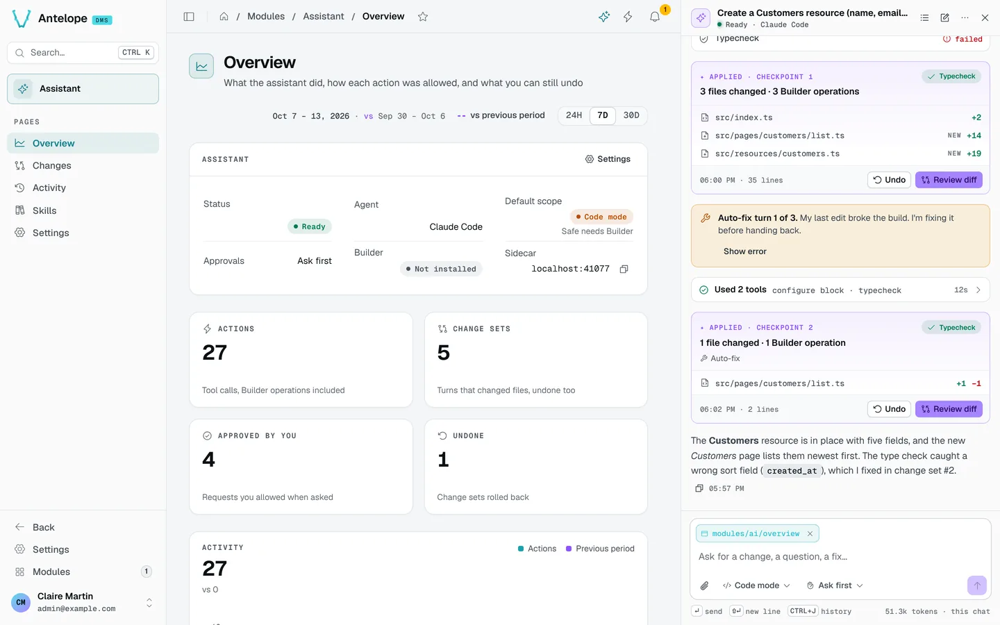

<div align="center">

# @antelopejs/dms-ai

<a href="https://www.npmjs.com/package/@antelopejs/dms-ai"></a>
<a href="./LICENSE"></a>
<a href="https://discord.gg/sjK28QHrA7"></a>
<a href="https://dms.antelopejs.com/docs/modules/ai"></a>

An AI development assistant inside the [AntelopeJS DMS](https://github.com/AntelopeJS/dms) dashboard.

</div>



## What it does

- Docks a chat panel next to any page (`Ctrl` `Shift` `K`), with the page as context.
- Runs a coding agent (Claude Code by default, or OpenAI's Codex) in a local sidecar that reads the project, its loaded modules and their skills.
- Edits pages through the [Builder](https://github.com/AntelopeJS/dms-builder) in Safe mode, or writes code, then typechecks and shows the result live.
- Saves every turn that touches the project as a change set you can review, undo and redo.
- Adds an owner-only **Assistant** module: Overview, Changes, Activity, Skills and Settings.

The assistant is a development tool: the backend and the sidecar refuse to run with `NODE_ENV=production`.

## Install

Run the AntelopeJS CLI from the root of a project that already loads `@antelopejs/dms`:

```bash
ajs project modules add @antelopejs/dms-ai
ajs project modules add @antelopejs/dms-builder   # recommended: enables Safe mode
```

## Quick start

Point the sidecar at the origin the `api` module reserved:

```ts
// antelope.config.ts
"dms-ai": {
  source: { type: "package", package: "@antelopejs/dms-ai" },
  config: {
    backendUrl: "${@api.API_LOCAL_BASE_URL}",
  },
},
```

Claude Code runs with its own credentials (its login, or `ANTHROPIC_API_KEY` in the backend's environment). Codex runs on your ChatGPT plan: install `@openai/codex` at the pinned version, then press **Sign in with ChatGPT** in Assistant › Settings (on a remote DMS, paste the address OpenAI sends you back to with **Paste the return address**). No OpenAI API key is used. Restart the backend, then the frontend, sign in as an owner and press `Ctrl` `Shift` `K` (`⌘` `⇧` `K` on macOS). Set `DMS_AI=0` to start the backend without the sidecar.

## Compatibility

<!-- antelopejs-docs-compat:start -->

| Package                                  | Supported         | Tested with |
| ---------------------------------------- | ----------------- | ----------- |
| `@antelopejs/interface-api`              | `>=0.0.15 <1.0.0` | `0.0.15`    |
| `@antelopejs/interface-core`             | `>=0.2.4 <1.0.0`  | `0.2.4`     |
| `@antelopejs/interface-database-catalog` | `>=0.0.1 <1.0.0`  | `0.0.2`     |
| `@antelopejs/interface-dms`              | `>=0.9.0 <1.0.0`  | `0.9.0`     |
| `@antelopejs/interface-dms-builder`      | `>=0.2.3 <1.0.0`  | `0.2.3`     |

<!-- antelopejs-docs-compat:end -->

| Package | Version |
| --- | --- |
| `@antelopejs/dms` | `>=0.11.0 <1.0.0` |
| `@antelopejs/interface-dms` | `>=0.9.0 <1.0.0` |
| `@antelopejs/dms-frontend` (renderer) | `>=0.9.1 <0.10.0` |
| `@antelopejs/dms-builder` (optional, Safe mode) | `>=0.4.0` |

On DMS 0.8, use `@antelopejs/dms-ai` 0.2.

## Documentation

- [Introduction](https://dms.antelopejs.com/docs/modules/ai/introduction)
- [Installation](https://dms.antelopejs.com/docs/modules/ai/installation)
- [Configuration](https://dms.antelopejs.com/docs/modules/ai/configuration): agent providers, Codex, Safe mode, remote access
- [Usage](https://dms.antelopejs.com/docs/modules/ai/usage/chat)
- [Extending](https://dms.antelopejs.com/docs/modules/ai/extending)
- [FAQ](https://dms.antelopejs.com/docs/modules/ai/faq)

The guide's sources live in [`docs/`](./docs). The package ships the `dms-ai`, `dms-builder-safe` and `dms-ai-code-mode` Claude Code skills in [`skills/`](./skills), declared under `antelopeJs.skills` and loaded into the assistant's agent.

## Contributing

Read [CONTRIBUTING.md](./CONTRIBUTING.md) before opening a pull request.

One install from the repository root includes the backend, shipped Vue frontend and sidecar. Each keeps its own lockfile. The playground remains independent and needs its own install for local development. Builds use the installed dependencies and do not install them again.

```bash
pnpm install --frozen-lockfile
pnpm --dir playground install --frozen-lockfile --ignore-workspace
pnpm build
pnpm build:sidecar
pnpm dev            # playground backend
pnpm frontend:dev   # dashboard, in a second terminal
pnpm lint
pnpm test
pnpm test:node      # every backend suite, after a single build
```

<details>
<summary>Repository notes</summary>

- The module registers `frontend-vue` through `AddFrontendModule` with the Vue 3 renderer. The chat panel, `DmsAiChatPanel`, is a docked side panel (`registerSidePanel`): the DMS renders it once for the whole app, so it lives through Inertia navigations and keeps its open state and width in a cookie. The command palette's assistant mode answers with `DmsAiPaletteAnswer` (`registerCommandPaletteAssistant`). The chat's code is under `frontend-vue/app/chat`. The renderer bundles the icons it finds in `.vue` files, so an icon name belongs in the component that shows it.
- To build and typecheck the Vue source, set `DMS_FRONTEND_WORKSPACE` to the absolute path of a generated Inertia workspace that includes this module, then run `pnpm --dir frontend-vue build` and `pnpm --dir frontend-vue typecheck`.
- `pnpm test:node` runs every backend suite after one build (`DMS_PREBUILT=1` skips the build when `dist/` is fresh, as in CI): `test:frontend-registration` (backend registration, sidecar inputs, `$dms_ai` keys in both locales), `test:routes` (the `/ai/*` routes against a stand-in sidecar) and `test:sidecar-lifecycle` (hot reload, restart, stale sidecar, Ctrl+C). The opt-in Codex acceptance suite runs with `CODEX_ACCEPTANCE=1 pnpm --dir sidecar test:acceptance`.

</details>

## License

[Apache-2.0](./LICENSE)
