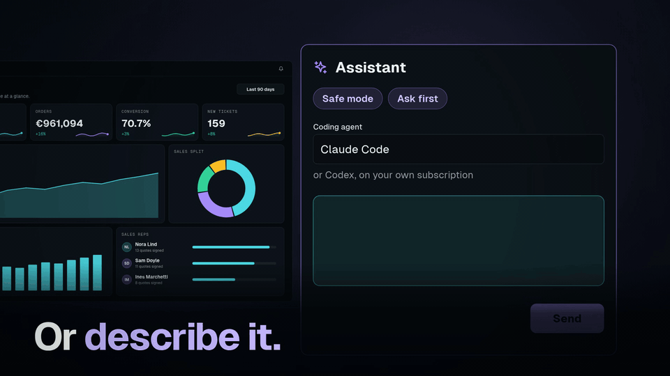

<a href="https://github.com/AntelopeJS/dms"></a>

<div align="center">

# `@antelopejs/dms-ai`

<a href="https://www.npmjs.com/package/@antelopejs/dms-ai"></a> <a href="./LICENSE"></a> <a href="https://discord.gg/g4pFt6eXqu"></a> <a href="https://dms.antelopejs.com/docs/modules/ai"></a> <a href="https://github.com/AntelopeJS/dms"></a>

**An AI development assistant inside the [AntelopeJS DMS](https://github.com/AntelopeJS/dms) dashboard.**

[Try it in the live demo](https://dms-demo.antelopejs.com/modules/ai) · [Documentation](https://dms.antelopejs.com/docs/modules/ai) · [All modules](https://github.com/AntelopeJS/dms#modules)

</div>



## What it does

- Docks a chat panel next to any page, with the page as context. `Ctrl` `Shift` `K` opens it.
- Runs a coding agent in a local sidecar. The agent is Claude Code by default, or OpenAI's Codex, and it reads the project, its loaded modules and their skills.
- Edits pages through the [Builder](https://github.com/AntelopeJS/dms-builder) in Safe mode, or writes code in Code mode. It then typechecks and shows the result live.
- Saves every turn that touches the project as a change set you can review, undo and redo.
- Adds an **Assistant** module for owners, with the **Overview**, **Changes**, **Activity**, **Skills** and **Settings** pages.

The assistant is a development tool. With `NODE_ENV=production`, the backend starts no sidecar and the dashboard shows no assistant. The sidecar exits if you start it yourself in production.

## Install

From the root of a project that already loads `@antelopejs/dms`, add the module with the AntelopeJS CLI:

```bash
ajs project modules add @antelopejs/dms-ai
ajs project modules add @antelopejs/dms-builder   # optional, turns on Safe mode
```

## Quick start

Point the sidecar at the origin that the `api` module reserved:

```ts fragment
// antelope.config.ts
"dms-ai": {
  source: { type: "package", package: "@antelopejs/dms-ai" },
  config: {
    backendUrl: "${@api.API_LOCAL_BASE_URL}",
  },
},
```

Claude Code runs with its own credentials, either its login or `ANTHROPIC_API_KEY` in the backend's environment. Codex runs on your ChatGPT plan and uses no OpenAI API key. To use Codex, install `@openai/codex` at the version that `peerDependencies` pins, then press **Sign in with ChatGPT** in **Assistant** › **Settings**. On a DMS that runs on another machine, finish the sign-in with **Paste the return address**.

Restart the backend, then the frontend. Sign in as an owner and press `Ctrl` `Shift` `K` (`⌘` `⇧` `K` on macOS). To start the backend without the sidecar, set `DMS_AI=0`.

## Requirements

<!-- antelopejs-docs-compat:start -->

| Package                                  | Supported         | Tested with |
| ---------------------------------------- | ----------------- | ----------- |
| `@antelopejs/agent-skills`               | `^0.1.0`          | `0.1.0`     |
| `@antelopejs/interface-api`              | `>=0.3.0 <1.0.0`  | `0.3.0`     |
| `@antelopejs/interface-core`             | `>=0.4.0 <1.0.0`  | `0.4.0`     |
| `@antelopejs/interface-database-catalog` | `>=0.0.1 <1.0.0`  | `0.0.2`     |
| `@antelopejs/interface-dms`              | `>=0.12.0 <1.0.0` | `0.12.0`    |
| `@antelopejs/interface-dms-builder`      | `>=0.4.0 <1.0.0`  | `0.4.0`     |

<!-- antelopejs-docs-compat:end -->

The module needs a DMS backend in a release that implements the `@antelopejs/interface-dms` range in the table. The dashboard needs an `@antelopejs/dms-frontend` renderer in the range that `engines["@antelopejs/dms-frontend"]` of `frontend-vue/package.json` declares. The `ajs dms` CLI refuses to build the module with a renderer outside that range. `@antelopejs/dms-builder` is optional and turns on Safe mode.

## Documentation

- [Introduction](https://dms.antelopejs.com/docs/modules/ai/introduction)
- [Installation](https://dms.antelopejs.com/docs/modules/ai/installation)
- [Configuration](https://dms.antelopejs.com/docs/modules/ai/configuration), with the agent providers, Codex, Safe mode, your own Claude Code session and remote access
- [Usage](https://dms.antelopejs.com/docs/modules/ai/usage/chat)
- [Extending](https://dms.antelopejs.com/docs/modules/ai/extending)
- [FAQ](https://dms.antelopejs.com/docs/modules/ai/faq)

The guide's sources live in [`docs/`](./docs). The package ships its agent skills in [`skills/`](./skills): `dms-ai`, `dms-ai-code-mode`, `dms-builder-safe`, `dms-external-database` and `dms-page-design`. `antelopeJs.skills` declares them, and the assistant loads them into its agent.

## Contributing

Read [CONTRIBUTING.md](./CONTRIBUTING.md) before you open a pull request.

One install from the repository root installs the backend, the shipped Vue frontend and the sidecar. Each of the three keeps its own lockfile. The playground is separate and needs its own install for local development. The builds use the installed dependencies and do not install them again.

```bash
pnpm install --frozen-lockfile
pnpm --dir playground install --frozen-lockfile --ignore-workspace
pnpm build
pnpm build:sidecar
pnpm dev            # playground backend
pnpm frontend:dev   # dashboard, in a second terminal
pnpm lint
pnpm test
pnpm test:node      # every backend suite, after a single build
```

<details>
<summary>Repository notes</summary>

- The module registers `frontend-vue` through `AddFrontendModule` with the Vue renderer. The chat panel, `DmsAiChatPanel`, is a docked side panel (`registerSidePanel`). The DMS renders it once for the whole app, so the panel stays mounted across Inertia navigations and keeps its open state and width in a cookie. The command palette's assistant mode answers with `DmsAiPaletteAnswer` (`registerCommandPaletteAssistant`). The chat's code is under `frontend-vue/app/chat`. The renderer bundles the icons it finds in `.vue` files, so an icon name belongs in the component that shows it.
- To build and typecheck the Vue source, set `DMS_FRONTEND_WORKSPACE` to the absolute path of a generated Inertia workspace that includes this module. Then run `pnpm --dir frontend-vue build` and `pnpm --dir frontend-vue typecheck`.
- `pnpm test:node` builds once, then runs every suite in `tests/` except the sidecar build smoke test (`pnpm test:sidecar-smoke`). `DMS_PREBUILT=1` skips the build when `dist/` is fresh, as in CI. Each suite also has its own script, for example `test:frontend-registration` (backend registration, sidecar inputs, `$dms_ai` keys in both locales), `test:routes` (the `/ai/*` routes against a stand-in sidecar) and `test:sidecar-lifecycle` (hot reload, restart, stale sidecar, `Ctrl` `C`). The opt-in Codex acceptance suite runs with `CODEX_ACCEPTANCE=1 pnpm --dir sidecar test:acceptance`.

</details>

## Part of AntelopeJS DMS

This module installs into [AntelopeJS DMS](https://github.com/AntelopeJS/dms), the open-source back office. Every module adds its pages to the same dashboard, behind the same sign-in and roles.

<!-- antelopejs-dms-modules:start -->

| Module                                                           | What it adds                                                                             |
| ---------------------------------------------------------------- | ---------------------------------------------------------------------------------------- |
| [`dms-builder`](https://github.com/AntelopeJS/dms-builder)       | Edit pages, tables and data sources by clicking, as TypeScript that compiles             |
| [`dms-ai`](https://github.com/AntelopeJS/dms-ai)                 | An assistant chat in the dashboard, on your own Claude Code or Codex                     |
| [`dms-database`](https://github.com/AntelopeJS/dms-database)     | Schemas, relation diagrams, a data browser and a query console                           |
| [`dms-api`](https://github.com/AntelopeJS/dms-api)               | API health, request logs, per-route statistics and a request tester                      |
| [`dms-automation`](https://github.com/AntelopeJS/dms-automation) | Node-graph automations on schedules, webhooks and DMS events, with a trace for every run |
| [`dms-mailing`](https://github.com/AntelopeJS/dms-mailing)       | E-mail templates in a block editor, versions, a send log and delivery metrics            |
| [`dms-lang`](https://github.com/AntelopeJS/dms-lang)             | Translation coverage, a translation matrix and a translation queue                       |
| [`dms-media`](https://github.com/AntelopeJS/dms-media)           | A media library with folders, per-folder permissions, image sizes and light editing      |
| [`dms-saas`](https://github.com/AntelopeJS/dms-saas)             | Self-service sign-up, plans that gate features, and Stripe billing                       |
| [`dms-marketing`](https://github.com/AntelopeJS/dms-marketing)   | Traffic, conversion funnels with A/B splits and click heatmaps, without cookies          |
| [`dms-frontend`](https://github.com/AntelopeJS/dms-frontend)     | The `ajs dms` CLI, the Vue renderer and the SDK every frontend module builds on          |

<!-- antelopejs-dms-modules:end -->

## License

[Apache-2.0](./LICENSE)
