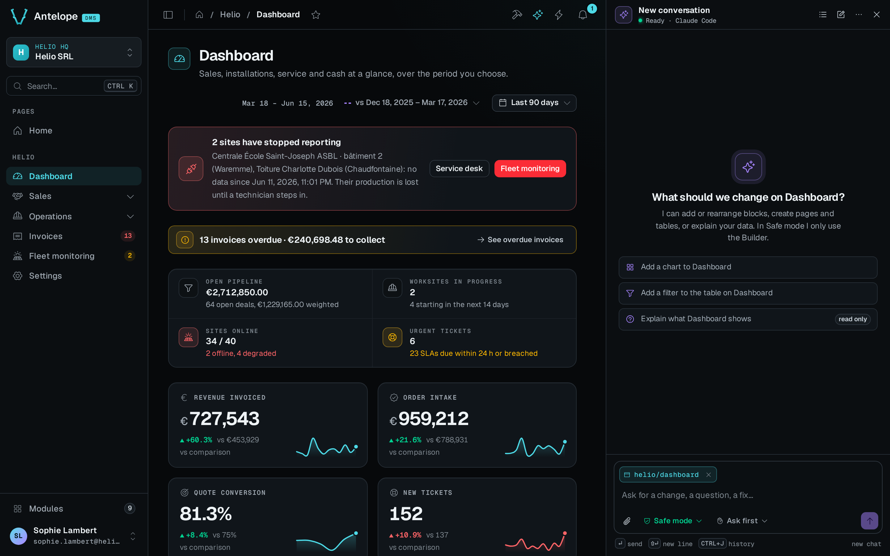
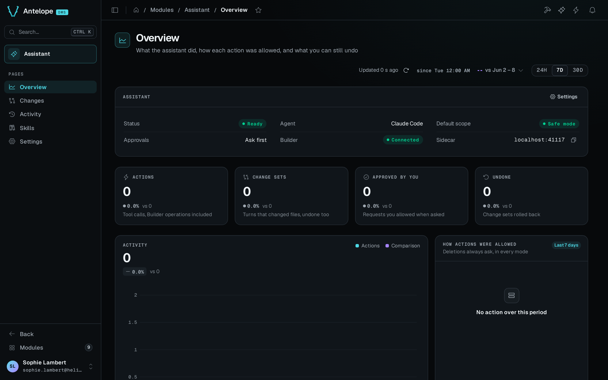

`@antelopejs/dms-ai` adds an AI development assistant to the DMS dashboard. You open the chat next to any page and ask for a change. The assistant reads the project and its loaded modules, then edits pages through the [Builder](/docs/modules/builder/introduction) or writes code. It typechecks the result and shows it live on the page you are looking at. Every turn that touches the project becomes a change set that you can review and undo.

## What it brings

::card-group
  :::card{title="Chat panel" icon="i-lucide-message-square" to="/docs/modules/ai/usage/chat"}
  A panel docked next to the page, kept open across navigations, with the page as context, approvals and inline change sets.
  :::

  :::card{title="Overview" icon="i-lucide-gauge" to="/docs/modules/ai/usage/overview"}
  The assistant's status, what it did over a period, how each action was allowed, and what you can still undo.
  :::

  :::card{title="Changes" icon="i-lucide-git-compare" to="/docs/modules/ai/usage/changes"}
  Every change set with its diff, Undo with a conflict preview, and Redo.
  :::

  :::card{title="Activity" icon="i-lucide-history" to="/docs/modules/ai/usage/activity"}
  The audit log of every tool call, with who allowed it and what came out.
  :::

  :::card{title="Skills" icon="i-lucide-book-open" to="/docs/modules/ai/usage/skills"}
  The skills loaded into the agent, shipped by your modules or by this machine.
  :::

  :::card{title="Settings" icon="i-lucide-settings" to="/docs/modules/ai/usage/settings"}
  The agent, its thinking, the approval mode, the scope, local skills and history.
  :::
::

## How it works

The module starts a sidecar, a local agent server that runs as a child process of the backend. The sidecar runs Claude Code by default, or OpenAI's Codex, in the project folder. The browser never talks to the sidecar directly. The chat goes through the DMS frontend server, over the same relay as the rest of the dashboard, to the backend, and from there to the sidecar on `127.0.0.1`.

The agent works with these tools and instructions:

- The skills of every loaded module, declared in `antelopeJs.skills`, including the core DMS skills such as `dms-best-practices`.
- The DMS tools `GetCurrentPage`, `ListPages`, `NavigateToPage`, `FindPagesUsing`, `QueryLogs`, `Typecheck`, `AskUser` and `PreviewBlocks`.
- `NavigateToPage` also waits for the page's data blocks to settle and lists the charts, KPIs, lists and tables that rendered empty or failed. A page that looks done but shows no data is therefore not reported as done. This needs an `@antelopejs/dms` with block states, and an older DMS gives the plain navigation result.
- The database catalog tools `DatabaseConnections`, `DatabaseRelations`, `DatabaseDescribe` and `DatabaseProfile`, which read the catalog and aggregates of a connected database, never its rows.
- The Builder tools, such as `BuilderCatalog`, `BuilderAddBlock`, `BuilderCreateResource` and `BuilderAddQuery`, when `@antelopejs/dms-builder` is loaded.

## Safe mode and Code mode

The scope setting decides what the agent may change in the project.

- Safe mode changes pages, tables and queries through the Builder only. Every change typechecks before it is written, and raw file edits and commands are blocked. Safe mode is the default, and it needs the Builder. Without `@antelopejs/dms-builder`, turns run in Code mode.
- Code mode can also edit any project file and run commands, following the approval mode. It is for custom logic that the Builder cannot express.

Safe mode is the better default. A Builder change is typechecked before it reaches a file, so a wrong edit fails in the chat and not in your build.

## A development tool

The assistant is for development only. With `NODE_ENV=production`, the backend starts no sidecar and the dashboard shows no assistant. The sidecar exits if you start it yourself in production. The dashboard also shows the assistant only in the development frontend, and only to a signed-in owner. The assistant's routes are reserved to owners. Remote development over a LAN, Tailscale, an SSH tunnel or a reverse proxy works wherever the dashboard does.

