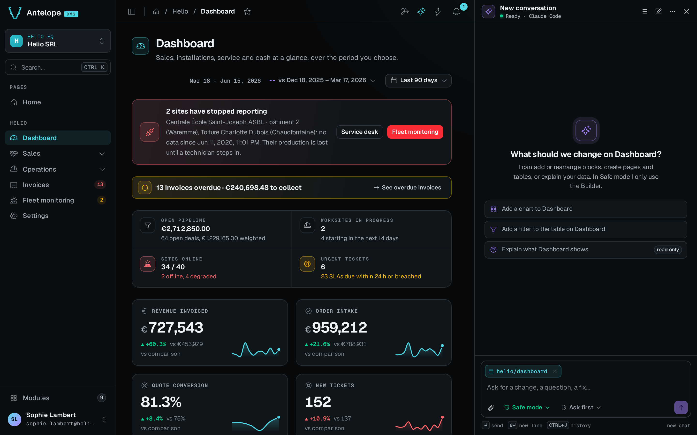
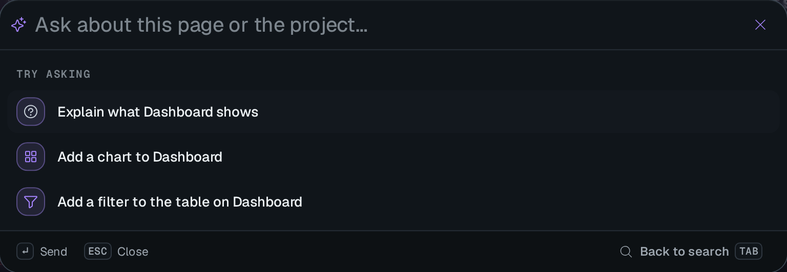

The chat is a panel docked next to the page, and the page shrinks to make room. The panel stays open across page navigations and reloads, and it follows the dashboard's theme. To open or close it, click the sparkle **Assistant** button in the dashboard header, or press `Ctrl` `Shift` `K` (`⌘` `⇧` `K` on macOS). Drag its edge to resize it.

*The Helio demo, before the first message. The sidecar is ready, and no model request has run yet. Opening the panel does not check your provider credentials. If the launcher is missing, see [Installation](/docs/modules/ai/installation).*

## Ask for a change

The composer sends the current page with your message. A chip in the composer shows the page path, and its close button removes it. Type a request and press `Enter`. `Shift` `Enter` adds a line.

A new conversation offers three starters that fit the page on screen. On the home page, they are **Create a page to list and edit a new kind of record**, **Create a table with its API routes**, and **Explain how this project is organised**. On a module page, they offer to add a block, rename labels, or explain the page. On any other page, they offer to add a chart, add a filter to the table, or explain the page. The explain starters are marked **read only**.

Under the text field, three controls set this conversation only:

- The scope. **Safe mode** changes the project through the Builder only. **Code mode** may edit any project file. Safe mode is unavailable without the Builder module.
- The approval mode. **Auto review** (Claude Code only), **Ask first**, **Accept edits** and **Plan only**. A new chat starts on Auto review with Claude Code and on Ask first with Codex.
- The attachment button, to add files such as a mockup or a screenshot. You can also drop files on the composer. A message takes up to 10 files of up to 25 MB each.

To open the list of conversations, press `Ctrl` `J` (`⌘` `J` on macOS) or click the history button in the panel header. In the list, `/` focuses the search. The header also has **New conversation** and a **More** menu with the rules allowed in this chat, **Open changes**, **Open activity** and **Settings**.

## Follow a turn

While the assistant works, it groups its tool calls under a header such as **Used 6 tools**, followed by the distinct actions (read file · edit file · run command) and the time the group took. Each row shows one call with its state: running, done, waiting for you, denied, blocked by safe mode, failed or stopped. The latest three rows stay visible, and a button reveals the earlier ones.

While a turn runs, `Enter` queues your next message, and the queue runs after the turn. `Esc` stops the turn. The agent can also send the dashboard to the page it edits, so you see the page reload as it changes.

In **Plan only**, the turn ends on a **Proposed plan** card with its steps and the note **Nothing has changed yet.** Click **Run with Ask first** to carry the plan out, or **Edit plan** to change it.

When the assistant asks you a question, a question card shows in the panel. It shows **Question 1 of 2** and the question's topic, the suggested answers, **Other…** for your own words, and **Skip, you decide**. Pick an answer, then click **Next** or **Send answers**.

### Read the change set card

Each turn that changed the project ends on a change set card. The card reads **Applied · checkpoint 1**, then the counts, such as **3 files changed · 3 Builder operations**, and the time and the number of changed lines. Below that come the typecheck result (**Typecheck**, **Typecheck failed** or **No typecheck**), and each file with its path, its status (new, changed or deleted) and its added and removed lines. An **Auto-fix** tag marks a set from an auto-fix turn. **May include changes from another chat** marks a set that ran while another conversation also changed files.

- **Review diff** opens the diff of the set.
- **Undo** restores the files to the checkpoint. When later change sets touched the same files, a dialog titled **Later change sets touch the same files** lists them. Choose **Undo them together** or **Undo this one only**.
- After an undo, the card reads **Undone · checkpoint 1 restored**, with the time and the name of the person who undid it, and offers **Redo**.

When its own edit breaks the build, the assistant starts an auto-fix turn before it hands back. A note reads **Auto-fix turn 1 of 2.**, lists the errors and has a **Stop auto-fix** button. The assistant makes at most two auto-fix turns.

## Answer requests

In **Ask first**, the assistant asks before every command, read-only ones such as `ls` and `cat` included, and before any change outside the Builder.

In **Accept edits**, the assistant applies file edits unasked, except edits of dependency and git hook files. It asks before every command, read-only ones included. With Codex, Accept edits works as Ask first: it asks before every file edit and before any command that writes.

**Plan only** changes nothing.

In **Auto review**, a safety check handles reads inside the project, routine file edits, web access and sub-agents. It approves the routine ones and blocks the risky ones, and the Activity page tells the two apart (*Allowed by Auto review*, *Blocked by Auto review*). Everything else asks you:

- Every shell command or scheduled task.
- Every read outside the project.
- Every tool that acts outside the chat, and any tool a Claude Code update adds.
- Every edit of a dependency or package-manager file (`package.json`, a lockfile, `pnpm-workspace.yaml`, `.npmrc`, `.pnpmfile.cjs`, `.yarnrc`, `.yarnrc.yml` or `bunfig.toml`), while **Always ask for** covers dependencies.

When the model, your plan or a setting does not allow Auto review, the chat shows a notice and asks first instead.

These actions ask in every mode, Auto review included:

- Deleting pages, tables, fields, categories or queries through the Builder.
- Mapping a database again when it would remove a page. The card lists the pages, and a denial writes nothing.
- Changing `antelope.config.ts` through the Builder.
- Adding or removing dependencies, while that toggle is on under **Always ask for** in Settings.
- Removing or moving Builder blocks, while that toggle is on under **Always ask for** in Settings.
- Editing a git hook file: anything inside a `.git` directory (hooks and config, those of submodules and worktrees included), `.husky/*`, a lefthook config file or `.pre-commit-config.yaml`. The **Always ask for** dependencies toggle does not apply to them.

With Codex, the sandbox is read-only in every mode, so every write asks. A request for one of these never offers to allow the next one for the rest of the chat. A card for a git hook file offers no rule that would let the next edit through unasked.

A request shows in the panel under **Needs your approval · 1 of 1**, with a countdown such as **denies in 4:59**. Its card names the action, for example **Run** and the command, and the effect, such as **adds a dependency**. **Review** opens the card with the diff, the full command or the address. Then answer the request:

1. To allow more than this one request, pick a rule under **Allow**, such as **Every edit to this file** or **Commands starting** a prefix. **Only this edit**, **Only this command** and **Only this request** allow the one request.
2. Click **Allow** (or **Allow edit**, **Allow command**, **Allow request**), or press `Enter`.
3. To refuse, click **Deny** or press `N`. To refuse and tell the assistant what to do instead, click **Suggest a change**, type the instruction, then click **Deny and send**.

With several requests waiting, `J` and `K` move between them, and **Deny all and stop** refuses them all. A rule lasts until the chat ends or the assistant restarts. The **More** menu lists the rules allowed in this chat. Select a rule there to revoke it.

A deletion asks you to type the name of what it deletes to confirm, then click **Delete**. When the deletion would also clear stored data, the card shows **Data loss** and offers **Keep the data, remove only the code**, marked recommended.

If nobody answers within the delay set in [Settings](/docs/modules/ai/usage/settings), the request is denied. A note says that the request expired and was denied, and the assistant is told why. **Ask again** sends the request back to the assistant. A denied call reads **denied** in its tool row, and the turn goes on without it.

When a request arrives while the panel is closed, a toast names it, with **Review** and **Later**. The toast needs **Notify me in the DMS**, which is on by default.

## Ask from the command palette

Open the command palette with `Ctrl` `K` (`⌘` `K` on macOS). Its **Assistant** group has **Open the assistant**, **New conversation**, **Review approvals** with the number waiting, and **Open changes**.

To ask a question without the panel, press `Tab` in the palette to switch to the assistant, then type the question. The answer is read-only, labelled **Read-only answer · Plan only, Safe mode**. To keep going, click **Continue in the assistant**, which moves the conversation to the panel.

## What the chat renders

The chat treats nothing the agent writes as markup:

- Markdown renders with raw HTML off, then an allowlist sanitizes it.
- Links go only to `http`, `https` or `mailto` addresses or to a page of the dashboard, and they open in a new tab.
- An image the model writes shows as a link.
- The agent can send the dashboard only to pages of the dashboard's own origin.

## Block previews

To compare layouts before the assistant changes a page, ask for alternatives, for example "Show two layouts for this page before changing it." You can attach a mockup to compare with.

When the assistant offers a preview, the conversation shows a **Block preview** card with its title, a thumbnail, and a line such as **3 blocks · 2 variants · vs your mockup**. To choose a direction:

1. Click **Preview** on the card. A dialog opens.
2. Compare the variants. The dialog has a tab for each variant. Each tab shows your mockup next to the **DMS blocks** pane, which renders the real blocks with your dashboard's theme.
3. Close the dialog and answer the assistant's question in the chat.

Switching tabs changes only the preview. It applies no layout to your page.

A view can show a custom sketch in place of DMS blocks. The thumbnail then carries a **Custom sketch** badge, and the dialog labels the pane as a custom sketch that is not a DMS block. A sketch is static HTML and CSS. It proposes a component, and it changes nothing in your project. When the dashboard has no `DmsBlockPreview` component, the dialog says that this DMS version cannot draw block previews and shows the tree the assistant sent as JSON.

Previews stay in the conversation. Attached mockup images do not stay on the server. After a reload, the dialog says the mockup can no longer be shown, and you attach it again to compare. An external image URL shows as **Open the mockup**, a link that the dashboard does not load.

Sketches cannot run scripts or submit forms. For payload limits, theme variables and CSP troubleshooting, see [Preview constraints](/docs/modules/ai/preview-constraints).
