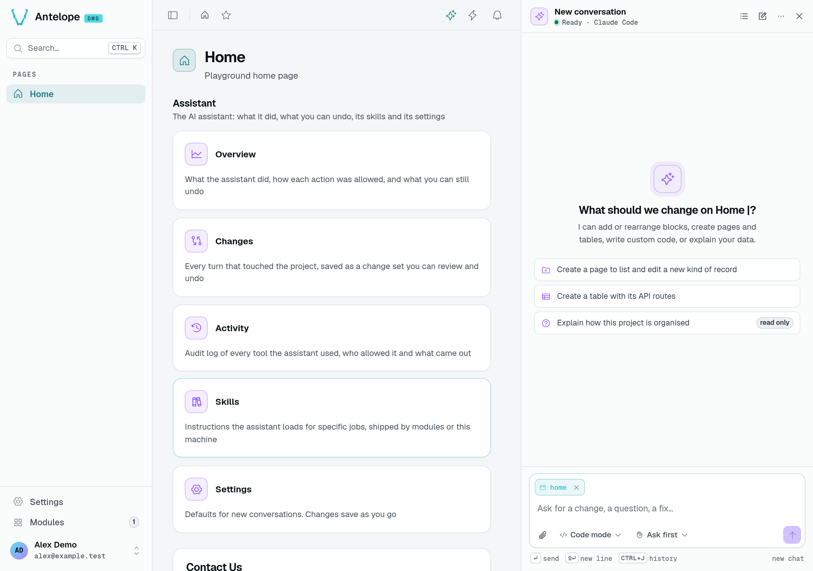
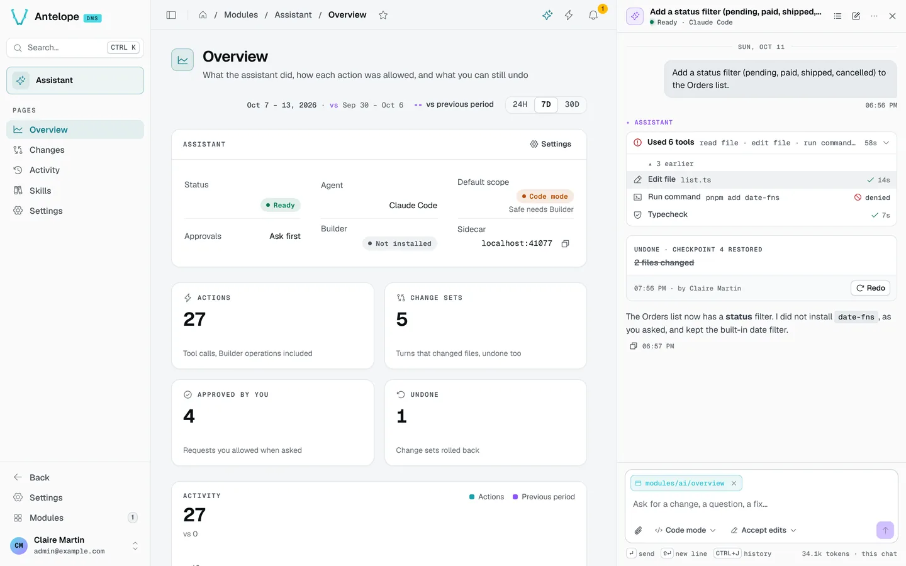
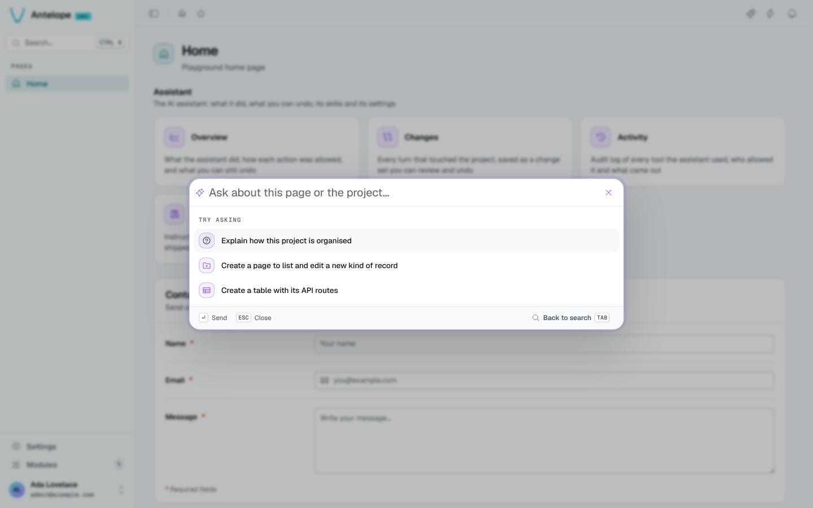
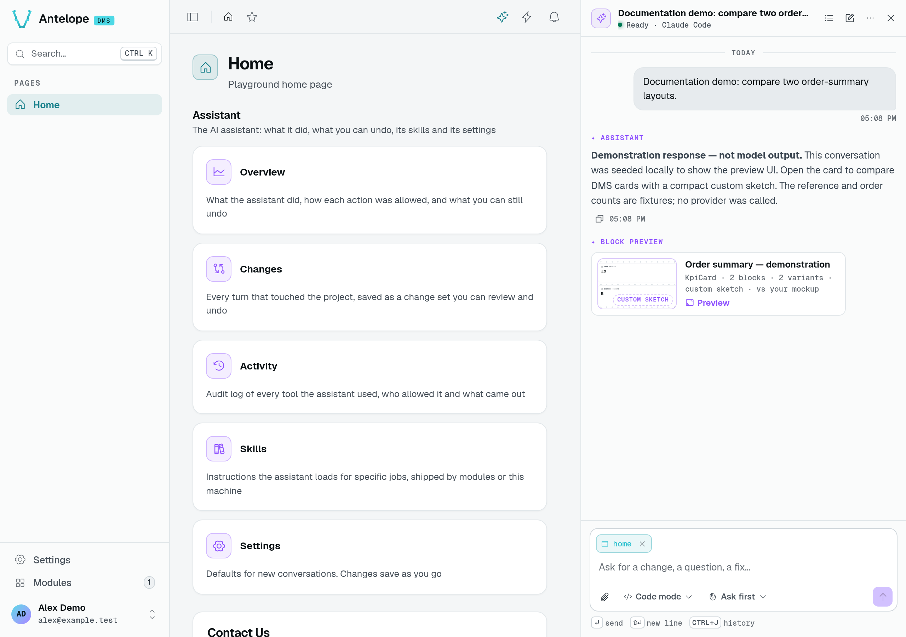
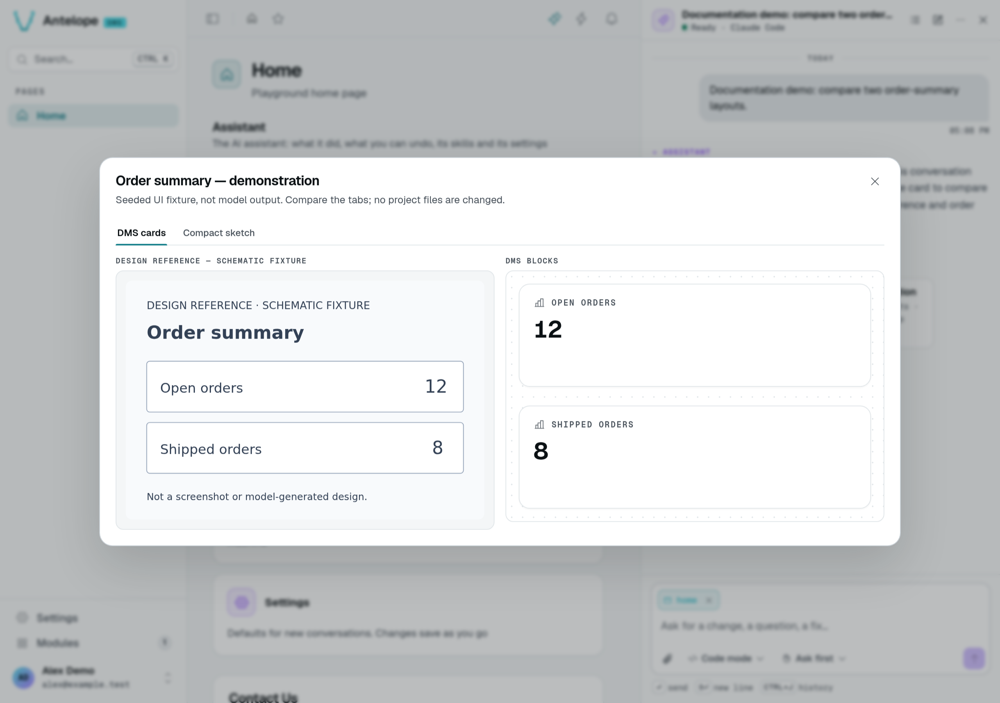
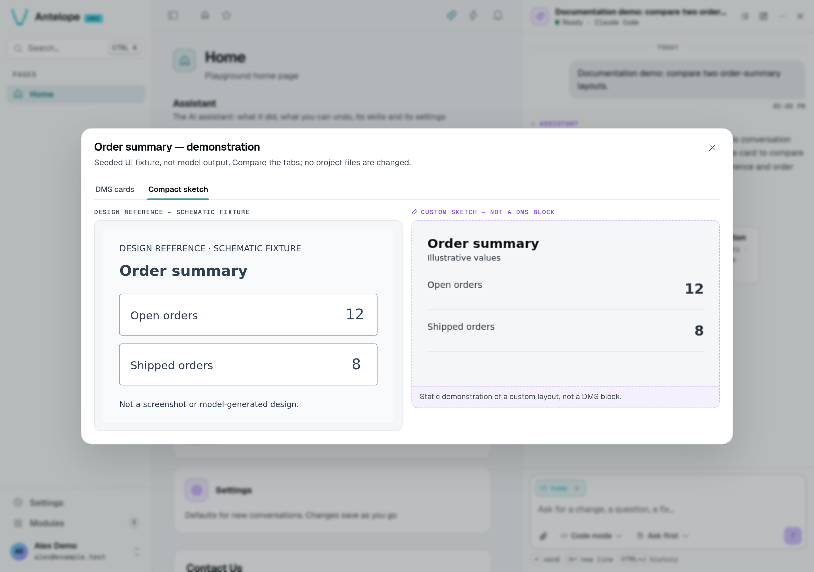

# Chat

The chat is a panel docked next to the page, which shrinks to make room. It stays open across page navigations and reloads, follows the dashboard's theme, and is toggled from the sparkle icon in the header or with `Ctrl` `Shift` `K` (`⌘` `⇧` `K` on macOS).

*A fresh local playground, before sending a message. The sidecar is ready, but no model request has run. Opening the panel does not verify your provider credentials. See [Installation](/docs/modules/ai/installation) if the launcher is missing.*

## Ask

The composer carries the current page as context (the page chip, removable). Type a request and press `Enter`; `Shift` `Enter` adds a line. A new conversation offers starters: create a page to list and edit a new kind of record, create a table with its API routes, or explain how the project is organised (read-only).

Under the composer:

- the **scope** of this chat: **Safe mode** (Builder only) or **Code mode**;
- the **approval mode** of this chat: **Ask first**, **Accept edits**, **Plan only**, or **Full auto** for a limited time;
- the attachment button, to add a file or an image (a mockup, a screenshot).

`Ctrl` `J` opens the history of conversations; the header has the history, a new conversation and the menu.

## Follow a turn

While it works, the assistant shows its tool calls grouped (*Used 6 tools: read file · edit file · run command…*), each with its duration and outcome. When it is on another page than the one it edits, it navigates the dashboard there, so the page hot-reloads under your eyes.

Each turn that changed the project ends on a **change set** card: *Applied · Checkpoint 1 · 3 files changed · 3 Builder operations*, the typecheck result, the files with their line counts, **Undo** and **Review diff**. When its own edit breaks the build, the assistant starts an **auto-fix turn** (up to three) before handing back.

## Answer requests

In **Ask first**, the assistant asks before any change outside the Builder. Some actions also require approval in other modes:

- Deleting pages, tables, fields or queries.
- Adding or removing dependencies, when their approval toggle is enabled under **Always ask for** in Settings.
- Removing or moving Builder blocks, when their approval toggle is enabled under **Always ask for** in Settings.

A request shows inline with **Allow** and **Deny**. A request nobody answers is denied after the delay set in [Settings](/docs/modules/ai/usage/settings). With the panel closed, a toast tells you a request is waiting.

## Ask from the command palette

In the command palette (`Ctrl` `K`), `Tab` switches to the assistant. It answers a question read-only, then hands the conversation over to the panel.

## What the chat renders

Nothing the agent writes is trusted as markup:

- Markdown is rendered with raw HTML off and sanitized against an allowlist.
- Links only go to `http`, `https`, `mailto` or a dashboard page and open in a new tab.
- An image the model writes is shown as a link.
- The agent can only navigate the dashboard to its own pages.

## Block previews

Ask for alternatives before committing to a layout, for example: “Show two layouts for this page before changing it.” You can attach a mockup for comparison.

When the assistant offers a preview:

1. Open its thumbnail card to inspect the proposal.
2. Switch tabs to compare variants, alongside your mockup when one is available.
3. Answer the assistant's question in the chat to choose a direction.

*This conversation was seeded in the local sidecar's transcript store. The response and preview data are demonstration fixtures, not model output. No provider was called.*

A preview can show real DMS blocks or a **Custom sketch — not a DMS block**. A sketch is a static HTML/CSS proposal, not a working feature or a change to your project. Without the dashboard's `DmsBlockPreview` component, block trees appear as JSON instead.

*Both screenshots show the preview opened from that conversation in the running module. The reference is a same-origin schematic fixture, not an uploaded customer mockup. Selecting a tab changes the preview only; it does not apply a layout to your page. These images demonstrate the UI, not AI generation or design fidelity.*

Previews stay in the conversation. Attached mockup images do not stay on the server: after a reload, attach the image again if the dialog asks for it. External image URLs appear as links rather than loading automatically.

Sketches cannot run scripts or submit forms. For payload limits, theme variables and CSP troubleshooting, see [Preview constraints](/docs/modules/ai/preview-constraints).
