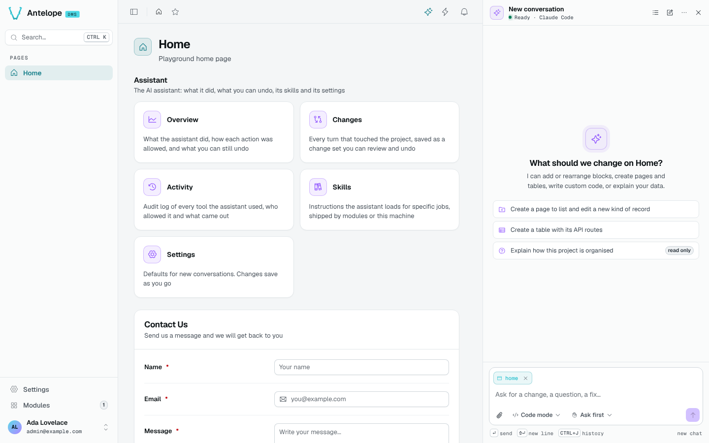

# Chat

The chat is a panel docked next to the page, which shrinks to make room. It stays open across page navigations and reloads, follows the dashboard's theme, and is toggled from the sparkle icon in the header or with `Ctrl` `Shift` `K` (`⌘` `⇧` `K` on macOS).

## Ask

The composer carries the current page as context (the page chip, removable). Type a request and press `Enter`; `Shift` `Enter` adds a line. A new conversation offers starters: create a page to list and edit a new kind of record, create a table with its API routes, or explain how the project is organised (read-only).

Under the composer:

- the **scope** of this chat: **Safe mode** (Builder only) or **Code mode**;
- the **approval mode** of this chat: **Ask first**, **Accept edits**, **Plan only**, or **Full auto** for a limited time;
- the attachment button, to add a file or an image (a mockup, a screenshot).

`Ctrl` `J` opens the history of conversations; the header has the history, a new conversation and the menu.

## Follow a turn

While it works, the assistant shows its tool calls grouped (*Used 6 tools: read file · edit file · run command…*), each with its duration and outcome. When it is on another page than the one it edits, it navigates the dashboard there, so the page hot-reloads under your eyes.

Each turn that changed the project ends on a **change set** card: *Applied · Checkpoint 1 · 3 files changed · 3 Builder operations*, the typecheck result, the files with their line counts, **Undo** and **Review diff**. When its own edit breaks the build, the assistant starts an **auto-fix turn** (up to three) before handing back.

## Answer requests

In **Ask first**, the assistant asks before any change outside the Builder. Some actions ask in every mode:

- Deleting pages, tables, fields or queries.
- Adding or removing dependencies.
- Removing or moving Builder blocks.

A request shows inline with **Allow** and **Deny**. A request nobody answers is denied after the delay set in [Settings](/docs/modules/ai/usage/settings). With the panel closed, a toast tells you a request is waiting.

## Ask from the command palette

In the command palette (`Ctrl` `K`), `Tab` switches to the assistant. It answers a question read-only, then hands the conversation over to the panel.

## What the chat renders

Nothing the agent writes is trusted as markup:

- Markdown is rendered with raw HTML off and sanitized against an allowlist.
- Links only go to `http`, `https`, `mailto` or a dashboard page and open in a new tab.
- An image the model writes is shown as a link.
- The agent can only navigate the dashboard to its own pages.

## Block previews

To settle a visual choice, the agent calls its `PreviewBlocks` tool with a tree of DMS blocks (`{ type, options, children }`), a title, an optional description, your mockup as `reference` and alternative trees as `variants`.

The chat shows the preview as an attachment, a card with a thumbnail, and the agent asks its question with buttons. The card opens a dialog that renders the real blocks beside the mockup, one tab per variant. A DMS without the `DmsBlockPreview` component shows the tree as JSON instead.

- A tree is capped at 8 levels, 200 blocks across its variants and, with the sketches, 64 KB of JSON. A block names a registry type, never an arbitrary component, and an option it loads from (`fetchUrl`…) must be a path of the site.
- The mockup is an image you attached in the conversation (`attachmentId`: its file name, or `latest`) or a same-origin path. An external URL is shown as a link, never loaded. Attached images are not kept on the server, so after a reload the dialog asks to attach the mockup again.
- The preview is stored in the transcript and comes back with the conversation.

### Custom sketches

A view (the preview or a variant) can carry a `sketch` instead of a tree, or beside it: static HTML and CSS (`{ html, css?, caption?, height? }`) of a custom component the agent proposes.

The dialog draws it in a frame labelled "Custom sketch — not a DMS block", so you compare the DMS option with the custom one before any code is written. The sketch's CSS can use `--sketch-*` variables that follow the dashboard's light or dark theme; images and fonts must be inline `data:` URLs.

### Sketch isolation

The sketch is the agent's own HTML, so it is drawn in an `<iframe sandbox="">` through `srcdoc`. The frame has:

- No scripts and an opaque origin.
- No forms, popups or top navigation.
- A Content-Security-Policy (`default-src 'none'; style-src 'unsafe-inline'; img-src data:; font-src data:`) that keeps it from loading anything.

The sidecar also refuses a sketch with a script, an event handler, a `javascript:` URL, an embedding or linking element, a `<meta http-equiv>`, an `@import` or a URL that is not `data:`, but the frame is the boundary.

A dashboard whose own CSP forbids inline styles applies it to the frame too, and the sketch then draws unstyled.
