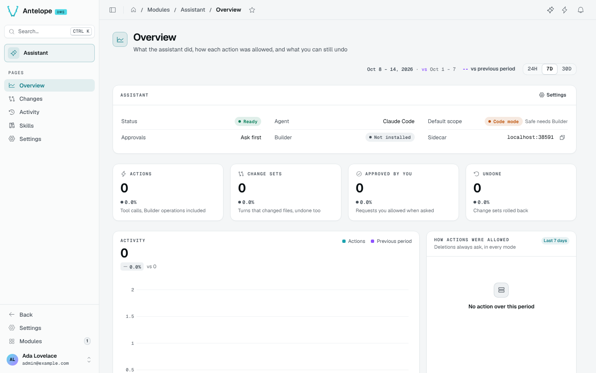

# Overview

The Overview (`/modules/ai/overview`) shows what the assistant did, how each action was allowed, and what you can still undo.

- The **toolbar** at the top says when the figures were last read, with a refresh button, then the period: **24H**, **7D** (the default) or **30D**, and its comparison menu: **vs previous period** (the default), **vs previous year** or **No comparison**, which hides the deltas and the chart's comparison line. The period you pick follows you to the Activity page.
- A **banner** appears when the assistant needs you: offline (with **Restart**), a failed turn, or requests waiting.
- **Assistant** lists the status (Ready, Busy, Offline), the agent, the default scope, the approvals, whether the Builder is installed, and the sidecar's address.
- Four KPIs over the period: **Actions** (tool calls, Builder operations included), **Change sets**, **Approved by you**, **Undone**.
- **Activity** charts the actions against the chosen comparison; **How actions were allowed** splits them by decision (read-only automatic, approved by you, denied, blocked by safe mode…).
- The latest change sets, with **Undo** and **Redo**, and the top tools.
