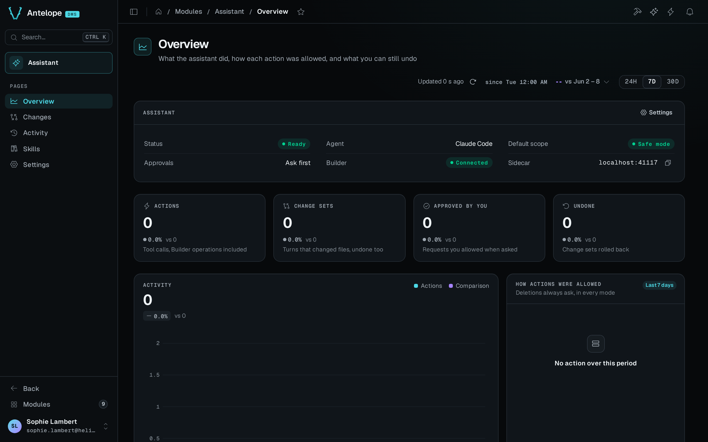

The Overview (`/modules/ai/overview`) is the module's first page. It shows what the assistant did, how each action was allowed, and what you can still undo.

## Toolbar

The toolbar at the top says when the figures were last read and has a refresh button. Then comes the period, **24H**, **7D** or **30D**, with **7D** as the default. The comparison menu offers **vs previous period** (the default), **vs previous year** and **No comparison**. **No comparison** hides the deltas and the chart's comparison line. The browser remembers the period you pick, and the Activity page opens on the same period.

## Banner

A banner appears when the assistant needs you. It shows the most pressing of these states:

- **The assistant is offline**, with a **Restart assistant** button. When the module's configuration turns the sidecar off, the banner says so and has no button.
- **The assistant's last turn failed**, with the error and an **Open activity** button.
- A count of requests waiting for you, such as **2 requests are waiting for you**.

## Assistant

The **Assistant** card has a **Settings** button and these rows:

| Row | Value |
| --- | --- |
| **Status** | **Ready**, **Working**, **Waiting for you** or **Offline**. Under it, how many requests wait for you or how many conversations are working. |
| **Agent** | **Claude Code** or **Codex**. |
| **Default scope** | **Safe mode** or **Code mode**. When Safe mode is the default but the Builder is missing, the row shows **Code mode** and **Safe needs Builder**. |
| **Approvals** | The default approval mode: **Ask first**, **Accept edits** or **Plan only**. |
| **Builder** | **Connected** or **Not installed**. |
| **Sidecar** | The sidecar's address, `localhost:<port>`, with a copy button, or **Not running**. |

While the assistant is offline, the card shows only **Status** and **Sidecar**.

## Key figures

Four cards count the period:

| Card | What it counts |
| --- | --- |
| **Actions** | Tool calls, Builder operations included. |
| **Change sets** | Turns that changed files, undone sets included. |
| **Approved by you** | Requests you allowed when asked. The caption gives the share of requests, such as `3 / 10 · 30%`. |
| **Undone** | Change sets rolled back, with a caption such as `1 / 4`. A rise reads as bad news. |

## Activity

The **Activity** chart draws the actions per day, against the comparison as a dashed line. Next to it, **How actions were allowed** counts the actions by the way they were allowed. It lists only the ways that occurred in the period:

- **Read-only, automatic**
- **Builder, automatic**
- **Approved by you**
- **Allowed by a rule**
- **Full auto**, for actions recorded before Full auto was removed
- **Allowed by Auto review**
- **Blocked by Auto review**
- **Blocked · safe mode**
- **Denied by you**
- **Expired**

When the assistant deleted something in the period, a last row, **Deletions asked**, counts the deletions it asked you about.

With a comparison, each key figure, each way of allowing and each top tool shows how it moved against the comparison window. When the comparison window counted zero, the row shows no trend.

## Changes

**Recent change sets** lists the four latest change sets with their number, title, scope, files, time and state. Each applied set has **Undo**, and each undone set has **Redo**. A click on a row opens it on the Changes page, and **All changes** opens the full list.

**Top tools** lists the five tools the assistant ran most over the period, each with its group, such as **Builder** or **Code mode**, and its run count.
