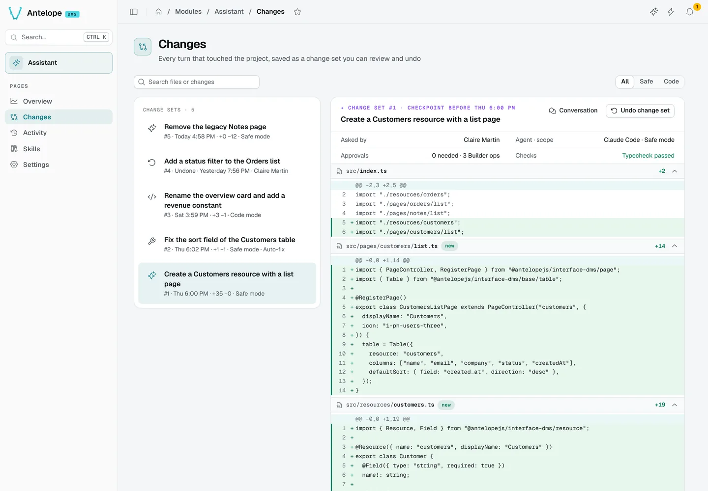
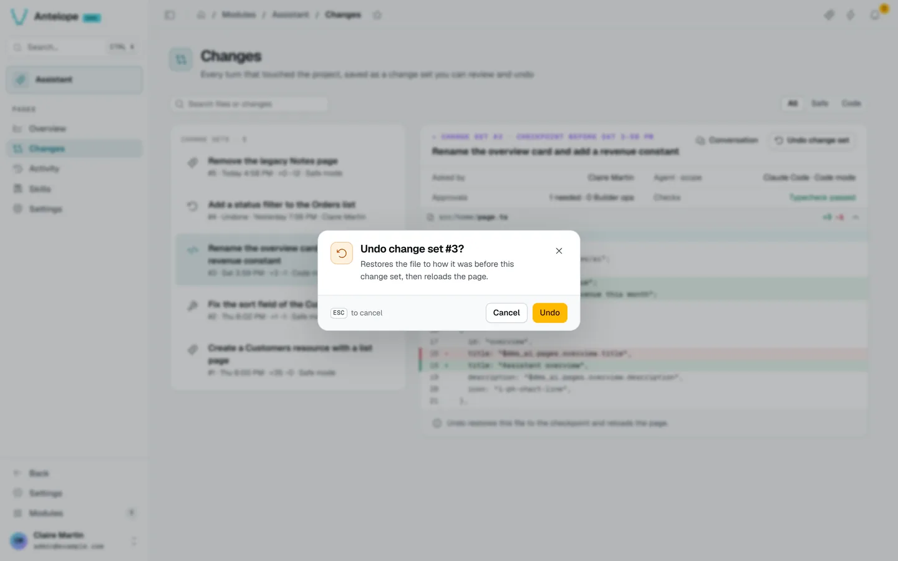

# Changes

Every turn that touched the project is saved as a change set: a checkpoint of the files before the turn, and the diff the turn produced. The Changes page (`/modules/ai/changes`) lists them; `?set=<id>` opens one.

## Read a change set

The list shows each set's title, number, time, line counts and scope (Safe or Code mode, auto-fix), and the undone ones. Filter **All**, **Safe** or **Code**, or search files and changes. A set shows who asked, the agent and scope, the approvals and Builder operations, the checks (typecheck), and the diff of each file. **Conversation** opens the chat it came from.

## Undo and redo

**Undo change set** restores the files to the checkpoint and reloads the page. When later change sets touched the same files, the dialog previews the conflict and offers to undo them too.

An undone set can be redone. Undo and Redo are recorded with the signed-in user's name. Checkpoints older than the retention set in [Settings](/docs/modules/ai/usage/settings) (7, 30 or 90 days) can no longer be undone.
