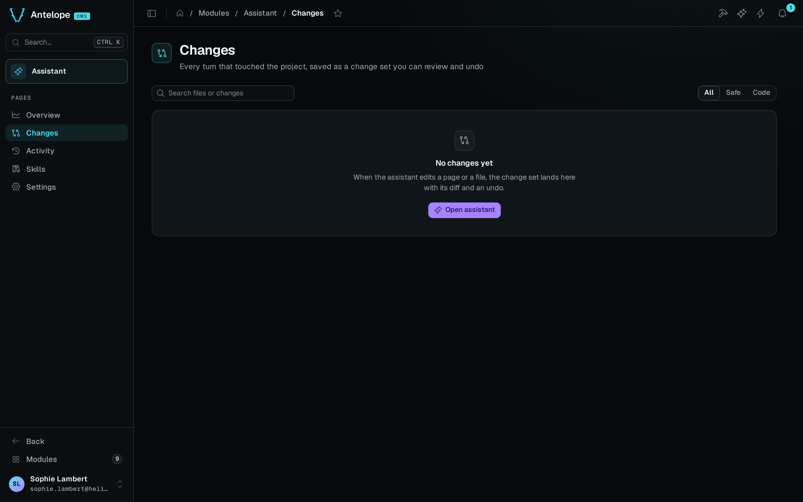

The assistant saves every turn that touched the project as a change set. A change set holds a checkpoint of the files before the turn and the diff that the turn produced. The Changes page (`/modules/ai/changes`) lists them, and `?set=<id>` opens one.

## Review a change set

1. Open **Changes** in the **Assistant** menu of the dashboard.
2. To narrow the list, type in **Search files or changes**, which matches titles and file paths, or pick a scope: **All**, **Safe** or **Code**.
3. Click a change set in the list. Each entry shows its title, its number, its time, its added and removed lines and its scope, with **Auto-fix** for a set from an auto-fix turn. An undone set shows when and by whom it was undone.

The open set starts with **Change set #3 · checkpoint before** and the time, then the title. Its rows show **Asked by**, **Agent · scope**, **Approvals** (such as **1 needed · 3 Builder ops**) and **Checks** (**Typecheck passed**, **Typecheck failed** or **Typecheck skipped**). Below the rows comes the diff of each file. A banner warns when the set may include changes from another chat that ran at the same time.

**Conversation** opens the chat the set came from. **Open page** opens the page the set changed, when there is one.

When Git is missing on the machine, the page says **Change sets are off**. The assistant can't save checkpoints until you install Git and restart the assistant.

## Undo a change set

1. Open the change set, then click **Undo change set**.
2. Read the dialog. It is titled **Undo change set #3?** and says how many files it restores.
3. If later change sets touched the same files, the dialog lists each one with its number, its title and the number of shared files. **Also undo the later change sets** is on by default. Undoing this set alone keeps their lines, and the code may not compile.
4. Click **Undo**.

The assistant restores the files to the checkpoint and the page reloads. A toast confirms the undo and offers **Redo**.

## Redo a change set

To put an undone set back, open it and click **Redo**. The files return as the assistant left them.

The module records each undo and redo with the signed-in user's name, or their email when they have no name. Change sets older than the checkpoint retention set in [Settings](/docs/modules/ai/usage/settings), 7, 30 or 90 days, can no longer be undone.
