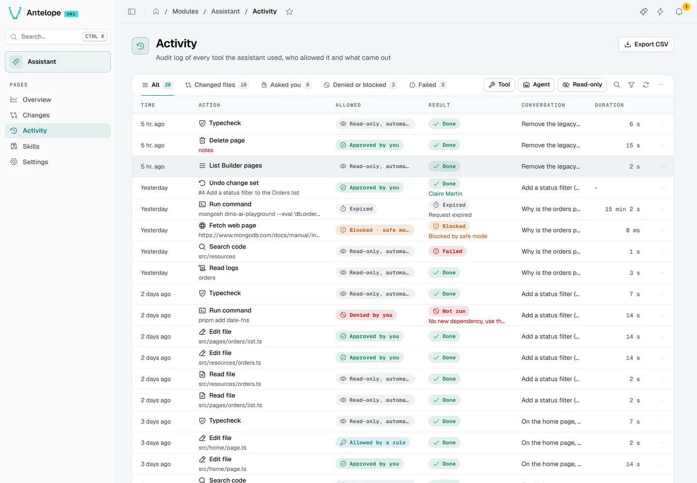
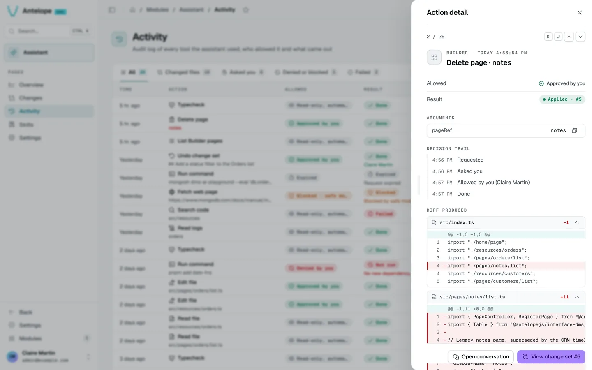

# Activity

The Activity page (`/modules/ai/activity`) is the audit log of every tool the assistant used.

- Tabs: **All**, **Changed files**, **Asked you**, **Denied or blocked**, **Failed**, with quick filters.
- Each row shows when, the action and its target, how it was allowed, and the result.
- **Export CSV** downloads the log.

## Action detail

Click a row to open its detail in a drawer on the right (`?record=<id>`). The drawer's header says where the action sits in the log ("Action 3 of 120"); its arrows, or `K` and `J`, step to the previous or next action. The detail shows the tool, how it was allowed, its result, its arguments, the **decision trail** (requested, asked you, allowed by whom, done), and the diff it produced. **Open conversation** and **View change set** jump to the context.

