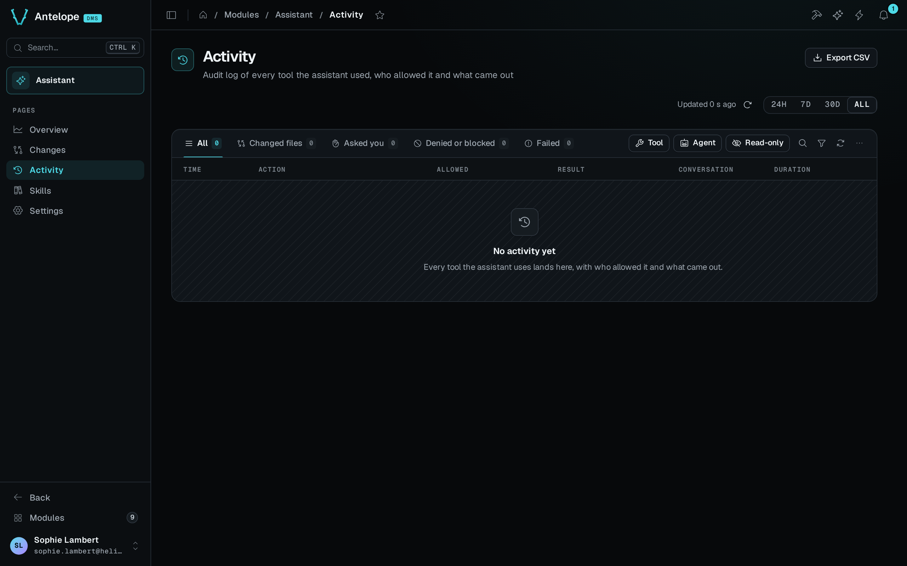

The Activity page (`/modules/ai/activity`) is the audit log of every tool the assistant used.

## The log

- The toolbar at the top says when the log was last read and has a refresh button. Then comes the period the log covers: **24H**, **7D**, **30D** or **ALL**. **ALL**, the whole log, is the default. A period picked on the Overview carries over.
- The tabs are **All**, **Changed files**, **Asked you**, **Denied or blocked** and **Failed**.
- The quick filters are **Tool**, **Agent** and **Read-only**, which hides the read-only calls.
- The search, **Search tools, files, pages**, matches the tool, its target and the conversation title.
- The columns are **Time**, **Action** (the tool and its target), **Allowed**, **Result**, **Conversation** and **Duration**. A deletion's target shows in red.
- The page loads 25 rows at a time, and **Load more** adds the next 25.
- **Export CSV**, in the page header, downloads the log as a CSV file of up to 10,000 rows, whatever the period, tab or filter.

**Allowed** takes one of these values: **Read-only, automatic**, **Builder, automatic**, **Approved by you**, **Allowed by a rule**, **Full auto** (actions recorded before Full auto was removed), **Allowed by Auto review**, **Blocked by Auto review**, **Blocked · safe mode**, **Denied by you** or **Expired**.

**Result** takes one of these values: **Done**, **Pending**, **Failed**, **Not run**, **Blocked**, **Stopped** or **Expired**.

When the sidecar is not running, the log says **Can't reach the assistant**. An empty log says **No activity yet**.

## Action detail

A click on a row opens its detail in a panel on the right, and `?record=<id>` links to it. The panel shows the row's position, such as `3 / 25`, and `J` and `K` step to the next and previous row.

The detail starts with the tool's group (**Builder**, **Code**, **Web**, **Project** or **Assistant**) and the time, then the action and its target, such as **Delete page · /orders**. Below that, it shows:

- **Allowed** and **Result**, as in the log. A finished call that made a change set reads **Applied** with the set's number, such as **Applied · #3**.
- **Arguments**, the arguments of the call, one per row.
- **Decision trail**, each step with its time. The trail starts at **Requested**. A request you were asked about adds **Asked you** and the decision, such as **Allowed by you** with your name. Otherwise, the trail gives the automatic decision, such as **Allowed automatically (Builder)**. It ends on **Done**, **Failed** or **Stopped**.
- **Diff produced**, the diff of an edit.
- **Output**, the tool's output.
- **Show raw JSON**, which shows the whole record.

**Open conversation** opens the chat the call came from. **View change set #3** opens the change set the call belongs to.
