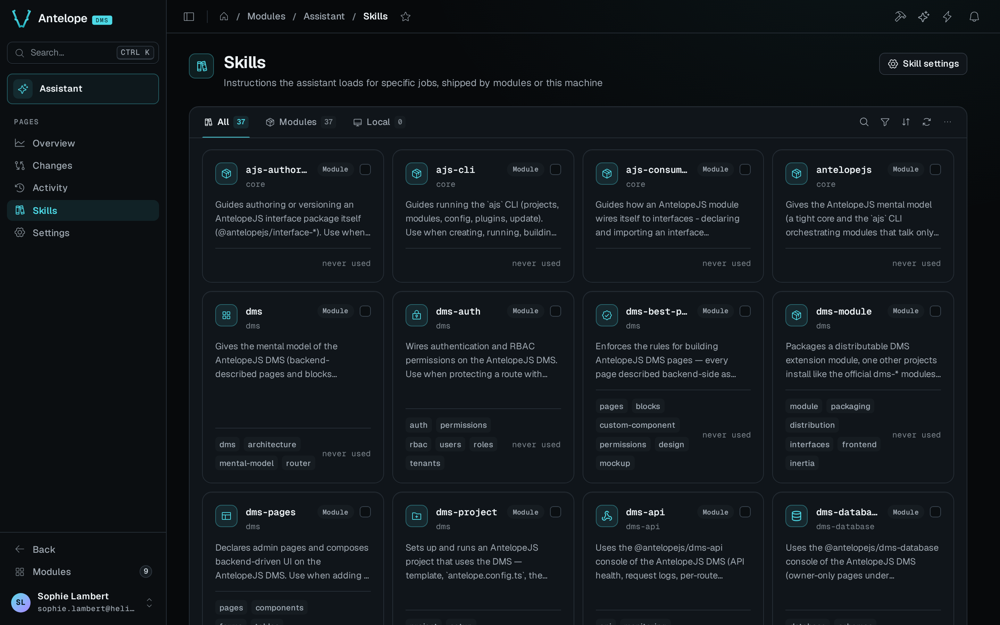
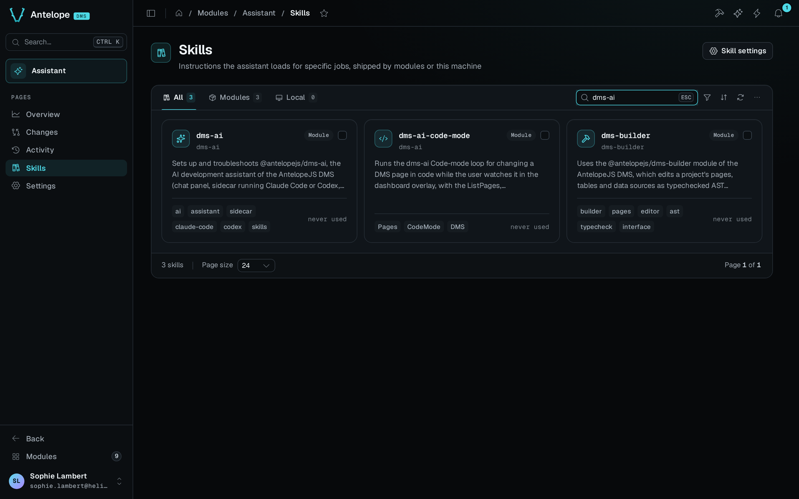
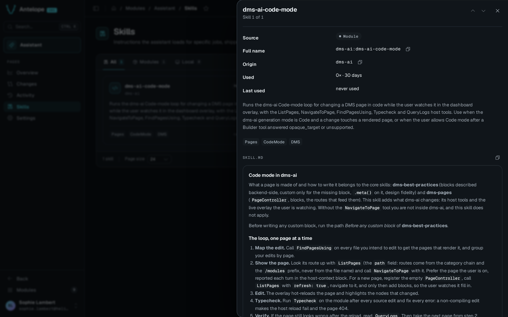

Skills are instructions the agent loads for specific jobs. The Skills page (`/modules/ai/skills`) shows them as cards.

*These cards come from the installed modules and their dependencies, so the count depends on your project. Inspecting them needs no model request.*

## Where skills come from

A skill's source is **Module** or **Local**:

- Module skills come from every loaded module that declares `antelopeJs.skills` in its `package.json`, from the dependencies of those modules, and from the project's own `dependencies` and `devDependencies`. The core DMS package ships `dms`, `dms-pages`, `dms-auth`, `dms-best-practices`, `dms-module` and `dms-project`. `@antelopejs/dms-ai` ships `dms-ai`, `dms-ai-code-mode`, `dms-builder-safe` and `dms-external-database`. The project's devDependencies bring the framework skills that `@antelopejs/core` ships.
- Local skills come from `~/.claude/skills` on this machine, when **Use machine-local skills** is on in [Settings](/docs/modules/ai/usage/settings). Teammates and other environments do not get them.

The **Skill settings** button in the page header opens that setting.

## The cards

The tabs are **All**, **Modules** and **Local**. The search box, labelled **Search name, module or tag**, narrows the cards. For example, in the Helio demo a search for `dms-ai` shows `dms-ai`, `dms-ai-code-mode` and `dms-builder`, whose description names the assistant. The cards are sorted by use over the last 30 days, most used first, 24 to a page.

A card shows the skill's name, the module it comes from, its description, its tags, its use count over the last 30 days or **never used**, and its source as a badge.

## Skill detail

A click on a card opens the skill in a reading panel on the right, 768 px wide on a large screen. The panel's header names the skill and its place in the list, such as **Skill 3 of 37**. Its arrows, or `K` and `J`, step to the previous and next skill.

The panel shows these rows: **Source**, **Full name**, **Origin**, **Used** (the count over 30 days) and **Last used**. Then come the description, the tags and the skill's `SKILL.md`, with a copy button. The `SKILL.md` text reflows to the panel's width. When a conversation used the skill, **Open last conversation** opens it.

## Duplicate names

::warning
When several skills share a name, the agent uses only one copy. A banner above the cards names the shared names. The other copies show a **Shadowed** badge, and their detail says which skill is used instead. Rename a copy to use both.
::

To ship skills of your own, see [Ship skills with your module](/docs/modules/ai/extending#ship-skills-with-your-module).
