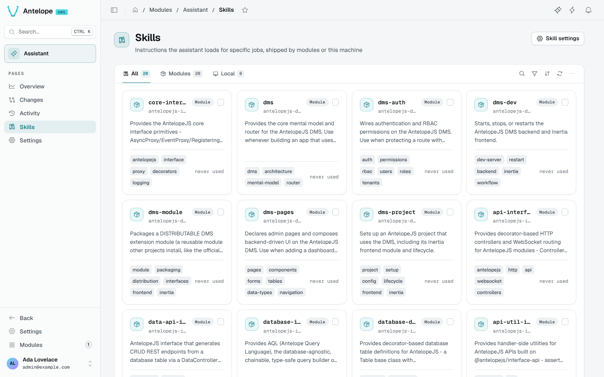
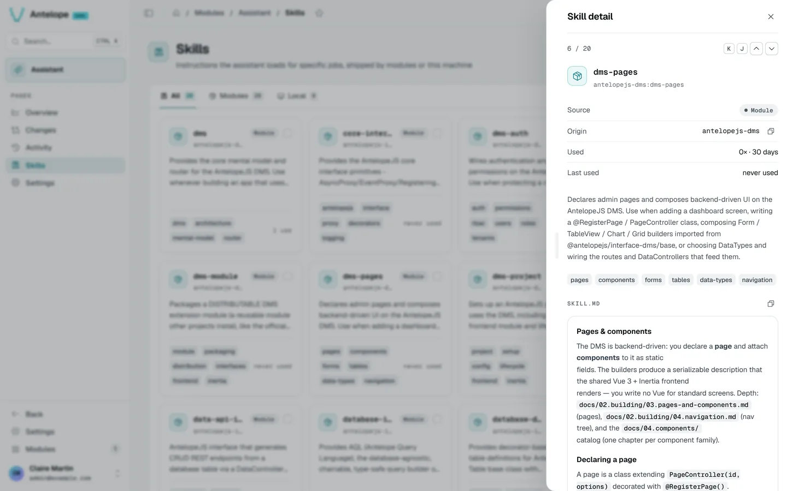

# Skills

Skills are instructions the agent loads for specific jobs. The Skills page (`/modules/ai/skills`) shows them as cards.

## Where skills come from

- **Modules**: every loaded module that declares `antelopeJs.skills` in its `package.json` contributes its skills: the core DMS skills (`dms`, `dms-pages`, `dms-auth`, `dms-best-practices`…), the AntelopeJS interfaces, and each dms-* module. Their dependencies count too, and so do the project's own `dependencies` and `devDependencies` (for example the framework skills `@antelopejs/core` ships).
- **Local**: skills from `~/.claude/skills` on this machine, when **Use machine-local skills** is on in [Settings](/docs/modules/ai/usage/settings). They are not shared with teammates or other environments.

The tabs filter **All**, **Modules** and **Local**. A card shows the skill's name, its module, its description, tags and when it was last used; click it for the full skill.

::warning
When two skills share a name, a banner names them: only one reaches the agent. Rename one of them.
::

To ship your own, see [Ship skills with your module](/docs/modules/ai/extending#ship-skills-with-your-module).
