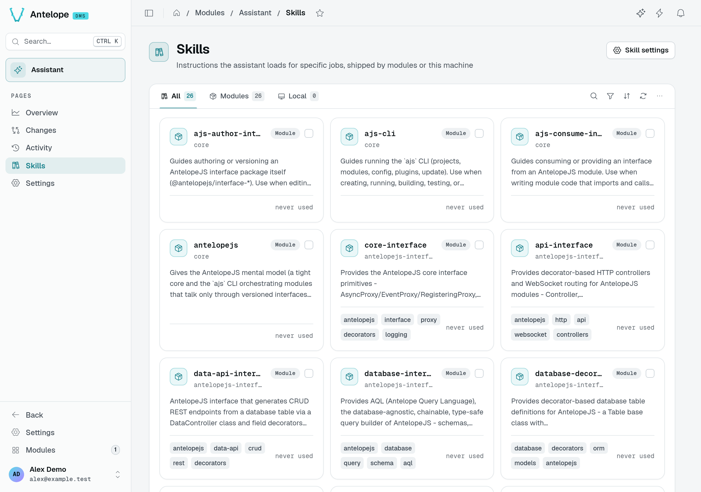
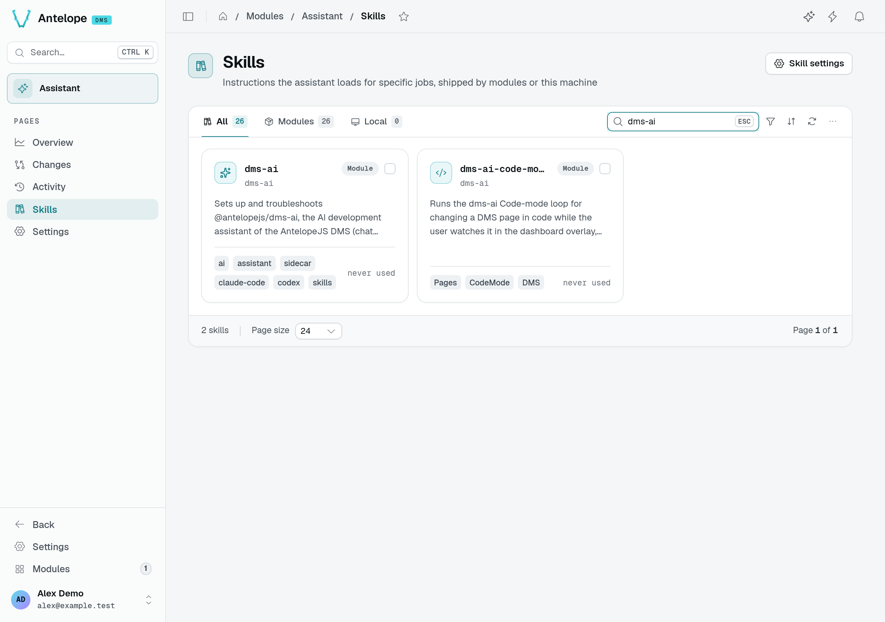
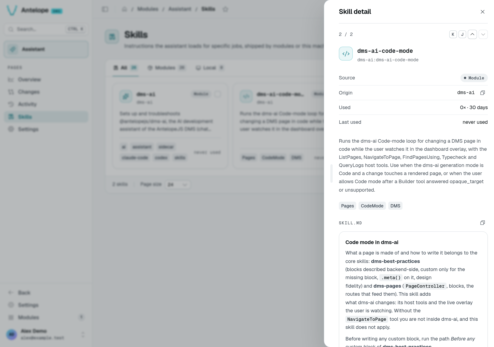

# Skills

Skills are instructions the agent loads for specific jobs. The Skills page (`/modules/ai/skills`) shows them as cards.

*These cards come from installed modules and dependencies. No model request is needed to inspect them; the count depends on your project's installed packages.*

## Where skills come from

- **Modules**: every loaded module that declares `antelopeJs.skills` in its `package.json` contributes its skills: the core DMS skills (`dms`, `dms-pages`, `dms-auth`, `dms-best-practices`…), the AntelopeJS interfaces, and each dms-* module. Their dependencies count too, and so do the project's own `dependencies` and `devDependencies` (for example the framework skills `@antelopejs/core` ships).
- **Local**: skills from `~/.claude/skills` on this machine, when **Use machine-local skills** is on in [Settings](/docs/modules/ai/usage/settings). They are not shared with teammates or other environments.

The tabs filter **All**, **Modules** and **Local**. A card shows the skill's name, its module, its description, tags and when it was last used; click it to read the full skill in a 768 px reading panel (narrower on a small window, the whole screen on a phone), its SKILL.md reflowed to the panel's width.

To find an instruction before using it, open search, enter part of its name, then click its card. For example, searching for `dms-ai` finds the setup and Code-mode skills in this playground.

::warning
When two skills share a name, a banner names them: only one reaches the agent. Rename one of them.
::

To ship your own, see [Ship skills with your module](/docs/modules/ai/extending#ship-skills-with-your-module).
