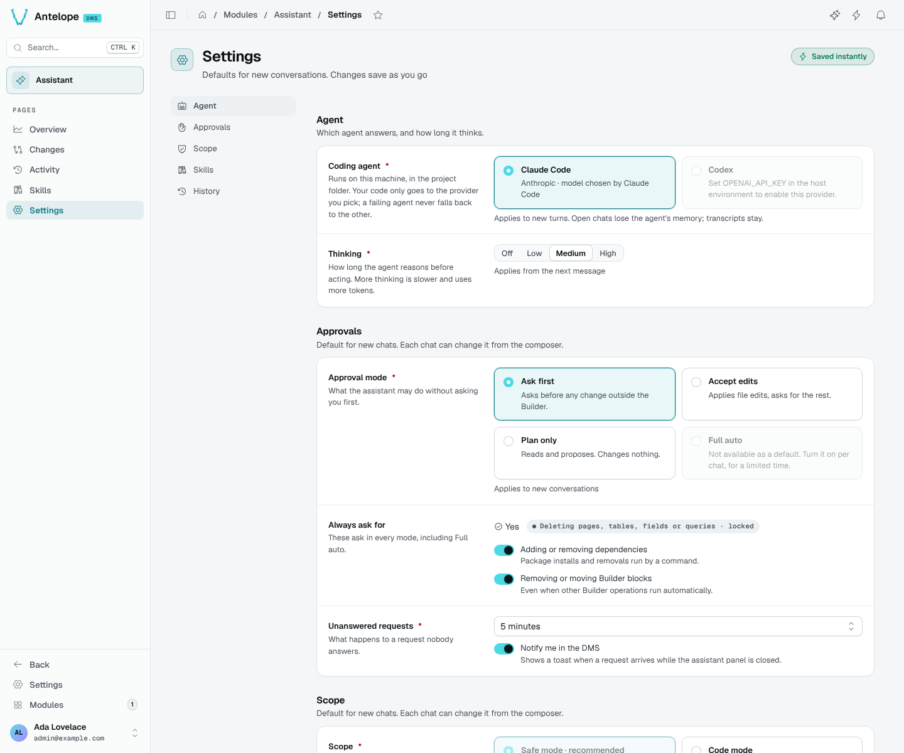

# Settings

The Settings page (`/modules/ai/settings`) holds the defaults of new conversations. Every change saves instantly.

| Section | Setting | Options |
| --- | --- | --- |
| Agent | **Coding agent** | Claude Code (default) or Codex. Applies to new turns; open chats lose the agent's memory, transcripts stay. |
| Agent | **Thinking** | Off, Low, Medium, High. Applies from the next message. |
| Agent | **Claude model** | Model Claude Code runs on, `claude-opus-5-5` by default. Thinking sets the effort (Low, Medium or High); Off disables thinking. Applies from the next message. |
| Approvals | **Default mode on Claude Code** | Auto review (default), Ask first, Accept edits or Plan only. Ask first asks before every command, read-only ones included, and before any change outside the Builder. Accept edits applies file edits unasked and asks before every command; with Claude Code, dependency and git hook files still ask there, with Codex they do not. Auto review lets a safety check approve routine file edits and web access and block risky ones; shell commands, scheduled tasks, edits of dependency files and git hook files, and any tool it does not know, still ask. Where the model, the plan or a setting does not allow it, the chat asks first and says so in a notice. |
| Approvals | **Default mode on Codex** | Ask first (default), Accept edits or Plan only. Codex has no Auto review. |
| Approvals | **Always ask for** | Deleting pages, tables, fields or queries (locked on), adding or removing dependencies, removing or moving Builder blocks. These ask in every mode, Auto review included. Edits of git hook files (anything inside a `.git` directory, `.husky/*`, lefthook and pre-commit config) always ask too and ignore the dependencies toggle. With Codex, Accept edits applies dependency and git hook file edits without asking. |
| Approvals | **Unanswered requests** | Deny after 5, 15 or 30 minutes; **Notify me in the DMS** shows a toast when a request arrives with the panel closed. |
| Scope | **Scope** | Safe mode (recommended, needs `@antelopejs/dms-builder`) or Code mode. |
| Skills | **Use machine-local skills** | Adds skills from `~/.claude/skills`. |
| History | **Checkpoints** | Keep 7, 30 or 90 days; older change sets can no longer be undone. |

The default mode is stored for each agent, so switching agent switches the default with it. A mode saved for the other agent is kept.

Each chat can change its approval mode and scope from the composer.

## ChatGPT account

A banner at the top of the page shows the ChatGPT account Codex runs on. **Sign in with ChatGPT** opens OpenAI's consent page in a new tab. When the DMS runs on another machine, the page OpenAI sends you back to does not load: copy its address and paste it with **Paste the return address**. **Sign out** revokes the session. See [Sign in with ChatGPT](/docs/modules/ai/configuration#sign-in-with-chatgpt).

## Usage

The bottom of the page counts the tokens the conversations used over the last 14 days, per day, with the totals and the biggest conversation. Claude Code's provider bills them; Codex's count toward your ChatGPT plan.
