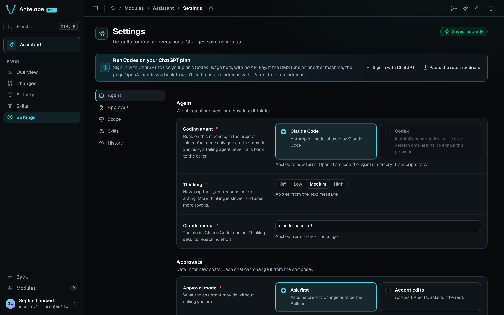

The Settings page (`/modules/ai/settings`) holds the defaults of new conversations. Each change saves as soon as you make it.

## Settings

| Section | Setting | Options |
| --- | --- | --- |
| Agent | **Coding agent** | **Claude Code** (default) or **Codex**. Applies to new turns. Open chats lose the agent's memory, and their transcripts stay. When Codex is not set up on this machine, its option is disabled and says why. |
| Agent | **Thinking** | **Off**, **Low**, **Medium** (default) or **High**. Applies from the next message. |
| Approvals | **Approval mode** | **Ask first** (default) asks before any change outside the Builder. **Accept edits** applies file edits and asks for the rest. **Plan only** reads and proposes, and changes nothing. **Full auto** shows disabled, because it is not a default. Turn it on per chat, for a limited time. |
| Approvals | **Always ask for** | **Deleting pages, tables, fields or queries** is locked on. **Adding or removing dependencies** and **Removing or moving Builder blocks** are on by default. These ask in every mode, Full auto included. |
| Approvals | **Unanswered requests** | **Deny after** 5 (default), 15 or 30 minutes. **Notify me in the DMS** (on by default) shows a toast when a request arrives while the panel is closed. |
| Scope | **Scope** | **Safe mode · recommended** (default) or **Code mode**. Safe mode changes pages, tables and queries through the Builder only. It needs `@antelopejs/dms-builder`, and without it the option is disabled. Code mode can also edit any project file and run commands. |
| Skills | **Use machine-local skills** | Off by default. Adds the skills in `~/.claude/skills` on this machine. |
| History | **Checkpoints** | **Keep 7 days**, **Keep 30 days** (default) or **Keep 90 days**. Older change sets can no longer be undone. |

Each chat can change its approval mode and scope from the composer.

## Account banner

A banner at the top of the page shows the ChatGPT account that Codex runs on. The banner appears only while the sidecar runs.

- Signed out, the banner reads **Run Codex on your ChatGPT plan**. **Sign in with ChatGPT** opens OpenAI's consent page in a new tab. OpenAI then sends you back to an address that starts with `http://127.0.0.1`. On the machine that runs the DMS, the sign-in completes by itself.
- When the DMS runs on another machine, that return page does not load. Copy its whole address, click **Paste the return address**, paste it into **Return address**, then click **Finish signing in**. The address works once, within 10 minutes.
- Signed in, the banner reads **Codex runs on the ChatGPT plan of** and your email. **Sign out** asks for confirmation, then revokes the session. Codex stops working on every DMS project of this machine until you sign in again.

See [Sign in with your plan](/docs/modules/ai/configuration#sign-in-with-your-plan).

## Usage

The **Usage** section counts the tokens that the conversations used over the last 14 days. **Tokens · last 14 days** charts them per day. **Last 14 days** gives the total tokens, the number of conversations and the biggest conversation. Your provider bills the tokens. With Codex signed in with ChatGPT, they count toward your plan's limits.
