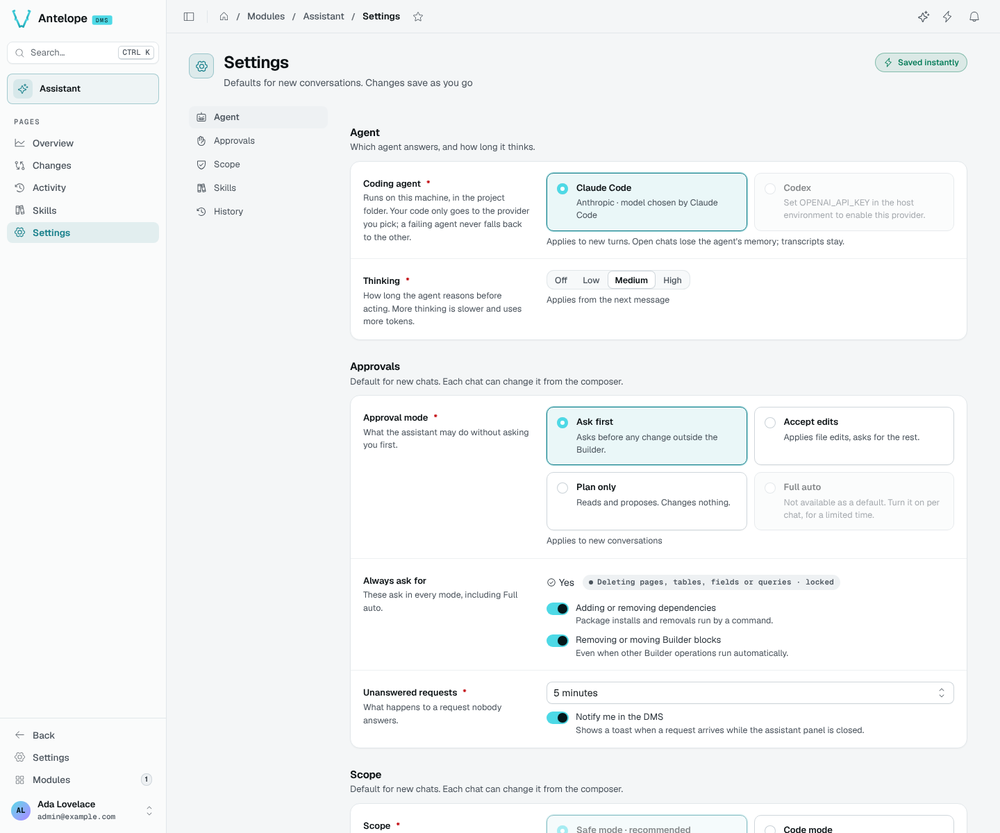

# Settings

The Settings page (`/modules/ai/settings`) holds the defaults of new conversations. Every change saves instantly.

| Section | Setting | Options |
| --- | --- | --- |
| Agent | **Coding agent** | Claude Code (default) or Codex. Applies to new turns; open chats lose the agent's memory, transcripts stay. |
| Agent | **Thinking** | Off, Low, Medium, High. Applies from the next message. |
| Approvals | **Approval mode** | Ask first (asks before any change outside the Builder), Accept edits, Plan only (reads and proposes). Full auto is not a default: turn it on per chat, for a limited time. |
| Approvals | **Always ask for** | Deleting pages, tables, fields or queries (locked on), adding or removing dependencies, removing or moving Builder blocks. These ask in every mode, Full auto included. |
| Approvals | **Unanswered requests** | Deny after 5, 15 or 30 minutes; **Notify me in the DMS** shows a toast when a request arrives with the panel closed. |
| Scope | **Scope** | Safe mode (recommended, needs `@antelopejs/dms-builder`) or Code mode. |
| Skills | **Use machine-local skills** | Adds skills from `~/.claude/skills`. |
| History | **Checkpoints** | Keep 7, 30 or 90 days; older change sets can no longer be undone. |

Each chat can change its approval mode and scope from the composer.

## Usage

The bottom of the page counts the tokens the conversations used over the last 14 days, per day, with the totals and the biggest conversation. Your provider bills them.
